# Tejas Joshi

**Computer Engineering Student · Backend Development, AI/ML & FinTech**

[Portfolio](https://tejas-joshi-portfolio.vercel.app/) · [LinkedIn](https://www.linkedin.com/in/tejas-joshi-cs/) · [Email](mailto:tejasjoshi966@gmail.com)

---

### about

Third-year student at KBTCOE Nashik (SPPU), building backend systems that solve real financial problems: credit scoring, fraud detection, reconciliation and risk. Looking for **backend and FinTech internships**.

### experience

- **Technical Intern, The Content Company** (Jun – Sep 2026): LangGraph data pipelines, OAuth 2.0 integrations and multi-tenant auth on AWS
- **BITSoM FinTech & AI program**: capstone on the Paytm FinTech Analytics & AI Platform

### selected work

| Project | What it does |
|---|---|
| [Paytm FinTech Analytics & AI Platform](https://github.com/Tejas966/Capstone-Project--Paytm-FinTech-Analytics-AI-Platform) | BITSoM capstone: SQL fraud detection, ledger-gateway reconciliation, credit-risk model and an AI advisory agent (synthetic data) |
| [QuickPay FinTech Operations Case Study](https://github.com/Tejas966/QuickPay_FinTech_Operations_Case_Study) | Payment data cleaning, SQL analysis, reconciliation and a Looker Studio dashboard |
| [SatarkAI](https://github.com/Tejas966/MPLADS-AI-Risk-Intelligence-) | AI anomaly detection for MPLADS projects · Smart India Hackathon 2026 · [live demo](https://mplads-ai-risk-intelligence-123.vercel.app/) |
| CrediSense | Alternative credit scoring for credit-invisible Indians · Pragyantra hackathon |

### stack

`Python` `FastAPI` `Flask` `SQL` `JavaScript` `TypeScript` `C` `C++` `Go (learning)` · `scikit-learn` `LangGraph` · `AWS` `Docker` `Git` `Supabase`

### stats

